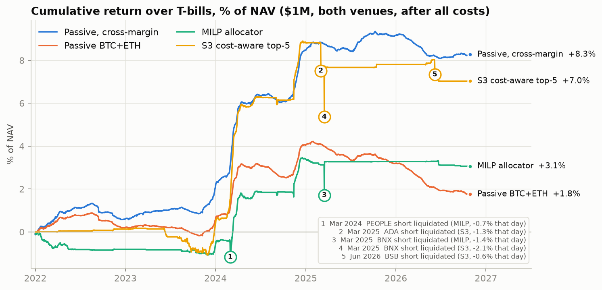

# Crypto Cash-and-Carry: Capital Efficiency in the Spot–Perpetual Basis Trade

Crypto perpetual futures charge a **funding rate** that works like a repo rate for leverage:
leveraged longs pay whoever supplies balance sheet. Buying spot and shorting the perp collects it
with no price risk. This project measures that carry with free exchange data (Binance, Bybit,
2021–2026, including later-delisted coins) and tests, under pre-registered rules, whether
funding forecasts or a mixed-integer allocator (HiGHS) beat simply holding
it. **They don't, after costs: the outcome is decided by capital structure, not selection.**

[](https://github.com/m23jung/crypto-cash-and-carry/actions/workflows/ci.yml)

**Read the paper: [PDF](docs/paper.pdf) · [web version](docs/paper.md) · [2-page summary](docs/summary.pdf)** · October 2026



## Key findings (2022–2026, out of sample, after all costs)

- **Carry over cash collapsed after 2021.** Passive BTC+ETH earned +12.6% over T-bills in 2021, then
  +0.36% a year in 2022–26 (Sharpe 1.10): the exchange's funding floor (10.95% a year) stayed fixed while
  T-bills rose from 0% to 5%.
- **Funding is forecastable, but the edge is the size of the cost.** A pooled regression ranks coins well
  (rank IC about 0.5); the top fifth earns 9.7% a year more than the average coin, but rotating weekly
  into it costs 10.4%.
- **No active strategy beat passive** at the same margin on a risk-adjusted basis, including a daily MILP
  optimiser (+0.63%, Sharpe 0.55; +1.45%, Sharpe 1.21 with turnover controls). None survives the
  correction for the 23 variants tried.
- **Capital structure decides the outcome.** The trade breaks even at about 1.4× capital per $1 of
  notional; under portfolio margin (1.05×), passive BTC+ETH earned **+1.94% a year over T-bills (Sharpe
  4.18)**. Returns are concentrated in high leverage-demand regimes.

## Documents

| | |
|---|---|
| **Paper** | |
| [docs/paper.pdf](docs/paper.pdf) ([markdown](docs/paper.md)) | Full paper |
| [docs/summary.pdf](docs/summary.pdf) ([markdown](docs/summary.md)) | Two-page summary |
| **Working notes** | |
| [docs/plan.md](docs/plan.md) | Research questions and every pre-registered spec and decision rule |
| [docs/decisions.md](docs/decisions.md) | Dated log of every analysis decision and correction |
| [docs/phase1.md](docs/phase1.md) … [docs/phase4b.md](docs/phase4b.md) | Findings per stage |
| [docs/sensitivity.md](docs/sensitivity.md) | Margin, leverage and transaction-cost sensitivity |
| [reports/](reports/) | Generated tables, one folder per stage, and figures |
| **Not in the results** | |
| [docs/extension_a.md](docs/extension_a.md) | Cross-venue funding gaps incl. on-chain venues (dropped when the project narrowed to single-venue carry) |
| [docs/extension_b.md](docs/extension_b.md) | Stock and commodity perps as synthetic financing (exploratory) |

## Layout

```
funding/        importable library
  sources.py    Binance / Bybit / FRED downloaders (plus Hyperliquid, dYdX, Yahoo for the extensions)
  store.py      SQLite cache
  panels.py     point-in-time universe, 8-hour funding, prices and basis
  dataset.py    venue panels and investable set shared by the stages
  forecast.py   funding features, models M0–M3, leak-free walk-forward
  backtest.py   8-hour spot/perp carry engine with P&L attribution
  metrics.py    Sharpe, drawdown, probabilistic and deflated Sharpe, paired bootstrap
  milp.py       daily single-venue MILP allocator (HiGHS via scipy.optimize.milp)
research/       one runnable script per step
  build_data.py
  phase1_descriptives.py
  phase2_forecast.py
  phase3_backtest.py
  phase4_allocator.py
  phase4b_allocator.py
  sensitivity.py
  figures.py
  export_pdf.py          markdown to PDF (headless Chrome, KaTeX)
  build_extensions.py    data for the extensions          ┐
  cross_venue_pnl.py     cross-venue trade with price leg │ not in the results
  extension_a_onchain.py on-chain venue comparison        │
  extension_b_tradfi.py  stock and commodity perps        ┘
reports/        generated tables by stage, and figures
docs/           paper, summary, plan, decisions, stage write-ups
tests/
data/           local cache (gitignored)
```

## Running it

```bash
python -m venv .venv && .venv/bin/pip install -e ".[dev]"
.venv/bin/python research/build_data.py          # ~1.5 h the first time (rate limits); resumable
.venv/bin/python research/phase1_descriptives.py # writes reports/phase1/report.md (descriptives)
.venv/bin/python research/phase2_forecast.py     # writes reports/phase2/report.md
.venv/bin/python research/phase3_backtest.py     # writes reports/phase3/report.md
.venv/bin/python research/phase4_allocator.py    # writes reports/phase4/report.md (~10 min)
.venv/bin/python research/phase4b_allocator.py   # MILP with turnover controls
.venv/bin/python research/sensitivity.py         # margin and costs (~15 min)
.venv/bin/python research/figures.py             # reports/figures/*.png
.venv/bin/python research/export_pdf.py docs/paper.md   # docs/paper.pdf (needs Chrome and internet for KaTeX)
.venv/bin/pytest
```
