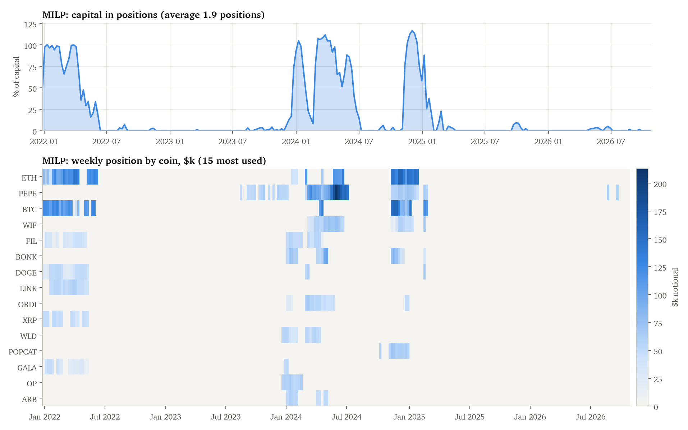
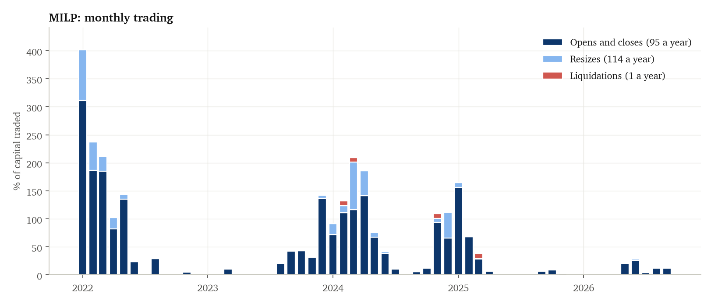
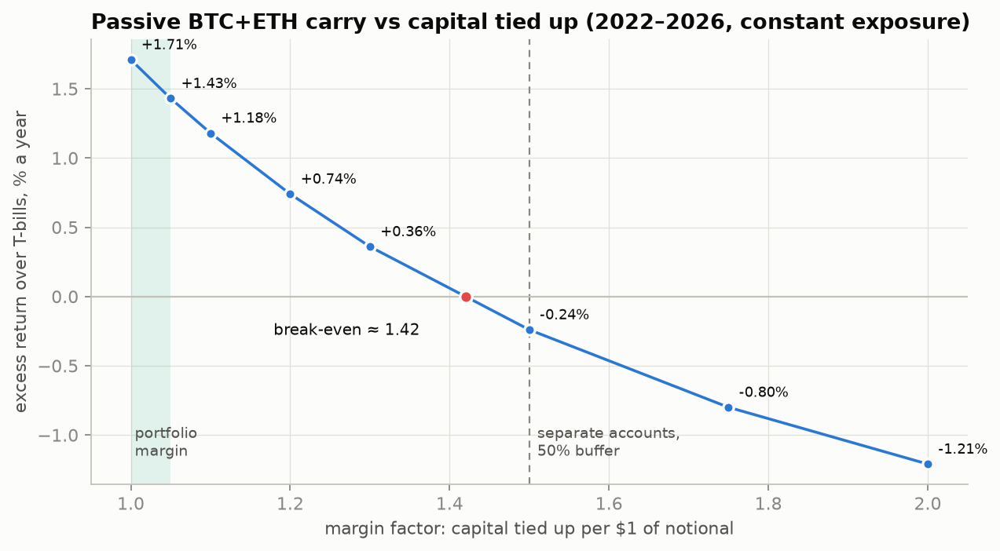

# Crypto Cash-and-Carry: Capital Efficiency in the Spot–Perpetual Basis Trade

## Summary

**Question.** Buying spot crypto and shorting the perpetual future ("perp") collects the perp's funding
rate with no price exposure: economically, a secured loan of cash. Can the trade be improved by
arbitraging funding across exchanges, by forecasting funding, or by optimising which coins to hold?

**Approach.** Free exchange data for 274 coins on Binance and Bybit (2021–2026, including later-delisted
coins), plus two on-chain venues (Hyperliquid, dYdX) from 2023. Every test had its decision rule written
down before it ran, and every variant is counted when judging statistical significance.

**Findings.**

- **Cross-venue arbitrage does not pay.** Binance and Bybit funding is 0.95 correlated; gaps close within
  hours and rarely exceed trading costs. Gaps to an on-chain venue are about twice as wide.
- **Carry over cash collapsed after 2021.** The exchange's funding floor (10.95% a year) stayed fixed while
  T-bills rose from 0% to 5%.
- **Funding is forecastable, but the edge is about the size of trading costs.**
- **No active strategy beat holding BTC and ETH passively**, including a daily MILP optimiser.
- **Capital structure decides the outcome.** The trade breaks even at about 1.4× capital per $1 of notional.
  Under portfolio margin (about 1.05×), passive BTC+ETH earned **+1.9% a year over T-bills (Sharpe 4.2)**;
  with spot and margin held separately (1.5×), +0.4%.


*Figure 1. Cumulative return over T-bills, $1M across both exchanges, after all costs (2022–2026). Labelled
dips are short-perp liquidations in price spikes on small coins (Section 3.3).*

---

## 1. How the trade works

**Perpetual futures** never expire. Instead, longs and shorts exchange a **funding payment** every 1–8 hours
that pushes the perp back towards the spot price:

- Perp above spot → longs pay shorts. Perp below spot → shorts pay longs.
- Binance's formula per 8 hours: **funding = premium + clamp(0.01% − premium, ±0.05%)**.
- For any small premium, the clamp returns exactly **0.01% per 8 hours = 10.95% a year**: an
  administered **floor**, much like an interest rate set by the exchange.

**The basis (cash-and-carry) trade:** buy *q* coins of spot, short *q* coins of the perp.

| P&L component | Source |
|---|---|
| Funding | received on the short perp each period (paid when funding is negative) |
| Basis change | gain or loss as the perp–spot gap moves |
| Trading costs | fees and slippage when opening, closing or resizing |
| Cost of capital | the T-bill interest given up on cash tied up in the position |

**Margin factor** = capital tied up per $1 of notional (spot plus margin for the short):

- **1.5** if spot and the short perp sit in separate accounts with a 50% buffer (the conservative case).
- **About 1.05** under portfolio margin, where spot counts as collateral at a 95% ratio.

> **Excess return over T-bills ≈ funding ÷ margin factor − T-bill rate − trading costs.**

All results below are in excess of the 3-month T-bill, net of all costs.

## 2. Data

- **Exchanges:** Binance and Bybit (funding, daily volume, 8-hour spot and perp prices, 2021–2026);
  Hyperliquid and dYdX funding from 2023; 3-month T-bill from FRED.
- **Universe:** each month, the top 30 coins by trailing Binance volume among coins on both exchanges,
  using only data available at the time: **274 coins**, including coins later delisted.
- **Investable:** in that month's universe, with a spot market on the same exchange and a perp–spot gap
  within ±20%. About **25 coins per exchange** from 2022.
- Stock, ETF and commodity perps are excluded. Full construction rules: Appendix A.

## 3. What was tried

### 3.1 Cross-exchange arbitrage

**Idea.** If funding differs between exchanges, short the perp where funding is high and buy it where it is
low. The position is price-neutral and collects the gap.

**Test** (decision rule fixed in advance):

- Signal: the average Binance–Bybit funding gap over the previous 3 days.
- Outcome: the gap collected over the next 7 days, in the signal's direction.
- Pass: the top 20% of signals must beat the 21 bp round-trip cost on average **and** in at least 4 of 6 years.

**Result: fails.** The top 20% collected 25 bp on average but beat costs in only 3 of 6 years.

| | 2021 | 2022 | 2023 | 2024 | 2025 | 2026 |
|---|---|---|---|---|---|---|
| Funding correlation, Binance vs Bybit | 0.71 | 0.82 | 0.95 | 0.95 | 0.94 | 0.95 |
| Top-20% gap collected over 7 days (bp) | 55.8 | 17.6 | 21.1 | 21.0 | 20.3 | 9.8 |

**Why.** Arbitrageurs already keep the two largest exchanges in line: the typical gap is 0.2–0.7 bp per
8 hours and halves in about 4.5 hours. What is left sits inside the cost of trading it.

**Where moving money is harder, gaps are wider.** On Hyperliquid, an on-chain exchange where capital moves
by bridging stablecoins rather than an exchange withdrawal, gaps against Binance on the same coins are:

| | Binance–Hyperliquid | Binance–Bybit (same coins) |
|---|---|---|
| Median gap (bp per 8 hours) | 0.62 | 0.32 |
| 90th-percentile gap | 3.40 | 1.63 |
| Top-20% gap collected over 7 days | 46 bp | 13 bp |
| Share of those trades beating the round-trip fee | 69% | 24% |

- The largest Hyperliquid gaps beat trading fees most of the time, but only before bridging costs,
  transfer delays and on-chain risk, which is exactly what keeps them open.
- The gap is shrinking: the top-20% 7-day gap fell from 54 bp (2024) to 14 bp (2026).
- dYdX shows wider gaps too, but its funding formula has no floor, so its gaps are largely mechanical and
  are not counted (Appendix A).

### 3.2 Forecasting funding

**Setup** (details in Appendix B):

- Target: each coin's average funding over the **next 7 days**.
- Four models: a constant (the 0.01% floor), last value, an exponentially weighted average (EWMA) and a
  pooled linear regression on recent funding averages, the perp–spot gap and time spent at the floor.
- Walk-forward: trained on 2021, tested out of sample from 2022, refitted monthly using only past data.

**Results** (out of sample):

| | Floor | Last value | EWMA | Regression |
|---|---|---|---|---|
| Forecast error, mean absolute (bp per 8h), range over 2022–26 | 1.06–2.17 | 0.96–2.00 | 0.82–1.68 | **0.72–1.39** |
| Ranking of coins: rank IC, range over years | — | 0.37–0.60 | **0.49–0.70** | 0.47–0.68 |
| Top 20% by forecast vs average coin (% a year, before costs) | — | 4.6–10.5 | 6.5–15.2 | 6.3–16.8 |

- Funding is clearly forecastable: a rank IC around 0.5 is very high (Appendix B explains the measure).
- The regression wins on error in 4 of 5 years and is used downstream; the EWMA ranks coins slightly better.
- **The catch:** rotating weekly into the top 20% costs about 15.6% a year (0.38% round trip × 52), about
  the same as the extra funding it identifies.

### 3.3 Rules for choosing coins

**Strategies** ($1M split across both exchanges, margin factor 1.5, 2022–2026):

| | Rule |
|---|---|
| **Passive** | hold BTC and ETH on both exchanges, always |
| **Naive top 5** | each week, rotate into the 5 coins with the highest forecast |
| **Cost-aware top 5** | enter a coin only if its forecast beats T-bills plus the round-trip cost spread over 7 days; exit only when the forecast falls below T-bills |

**Results:**

| | Excess return a year | Sharpe | Max drawdown | Turnover (× capital a year) |
|---|---|---|---|---|
| **Passive BTC+ETH** | **+0.36%** | **1.10** | −2.5% | 0.1 |
| Naive top 5 | −4.31% | −1.68 | −19.0% | 31.3 |
| Cost-aware top 5 | +1.46% | 0.83 | −3.5% | 3.0 |
| Cost-aware top 5, EWMA forecast | +2.56% | 1.35 | −2.3% | 2.4 |

None of the active rules beats passive on a risk-adjusted basis (the cost-aware rule's Sharpe is lower,
P(not better) = 0.51), and none survives the correction for the number of variants tried (Appendix B).

**Why:**

- **Naive rotation is eaten by costs:** the most funding collected (5.8% of capital a year) but 6.0% paid in
  costs and 0.6% in liquidation penalties.
- **The cost-aware rule mostly sits in cash:** spreading a 0.38% round trip over only 7 days requires
  forecast funding of about 24% a year to enter, so it held 1.7 coins on average out of 10 slots.
- **Small coins bring liquidations.** Every numbered dip in Figure 1 is a short perp liquidated in a price
  spike on a small coin: PEOPLE (March 2024), ADA (March 2025, when it jumped on the US "crypto strategic
  reserve" announcement), BNX (March 2025, −2.1% in a day, mostly reversed the next day) and BSB (June 2026).
  Each costs a 2% penalty plus a loss on the leftover spot, which is sold at the next 8-hour close after
  the spike has partly reversed. BTC and ETH were never liquidated.

### 3.4 A daily optimiser (MILP)

**How it is used.** Once a day, a mixed-integer program (solved with HiGHS) decides how much of each coin to
hold on each exchange, and whether to move capital between exchanges. Trades execute at the next 8-hour
close.

- **Maximises:** expected funding over 30 days, minus the T-bill on capital used, minus trading costs
  (charged in full when a position opens), minus a risk penalty for small and newly listed coins.
- **Constraints:** capital per exchange; per-coin caps (25% of an exchange's capital for BTC/ETH, 10% other
  coins, 5% coins listed under 90 days); at most 1% of a coin's daily volume; $10k minimum position;
  at most 12 positions; at most 60% of capital on one exchange; transfers of at least $50k that arrive a
  day later.
- **Forecast:** the regression, refitted for a 30-day target.
- Full formulation: Appendix D.

**Results:**

| | Margin | Excess return a year | Sharpe | Turnover | Costs a year |
|---|---|---|---|---|---|
| Passive BTC+ETH | 1.50 | +0.36% | 1.10 | 0.1 | 0.03% |
| **MILP** | 1.50 | +0.67% | 0.67 | 5.3 | 1.07% |
| MILP with turnover controls* | 1.05 / 1.30 | +1.53% | 1.32 | 4.1 | 0.82% |
| **Passive BTC+ETH, portfolio margin** | **1.05** | **+1.94%** | **4.18** | 0.2 | 0.04% |

\* *Exit costs charged in the objective, a no-trade band (trades smaller than $5k or 10% skipped), and
realistic portfolio margin (1.05 for BTC/ETH, 1.30 for other coins).*

**Why it does not beat passive:**

- It does what it was designed to: fully invested during the high-funding periods of 2024, in T-bills
  otherwise, with fewer liquidations than the coin-picking rules (Figure 2).
- But it **gives much of the carry back in trading:** about 100 opens and closes a year as forecasts
  change (Figure 3). Turnover controls cut that by a third and doubled the return, still well short of
  passive under the same margin.
- The extra funding in small coins comes with **higher margin factors, liquidations and basis losses**.
  Passive BTC+ETH trades almost never and ties up the least capital (Figure 4).



*Figure 2. MILP capital deployed and weekly positions by coin. Fully invested in 2022 and the 2024 rallies;
mostly in T-bills otherwise.*



*Figure 3. MILP trading by month: opens and closes dominate, concentrated in the high-funding periods.*


*Figure 4. Annual P&L by source. Funding adds (blue); the largest drag in every strategy is "cash − T-bill",
the interest given up on capital tied up in positions.*

## 4. What is left: single-exchange basis carry

With selection and arbitrage ruled out, the return is the carry itself, and how much of it survived
2021 depends on the regime:

| Year | Context | BTC funding (% a year) | Median coin funding | T-bill | Funding prints negative |
|---|---|---|---|---|---|
| 2021 | Bull market, retail leverage | 30.6 | 10.95 | 0.05 | 8% |
| 2022 | LUNA, 3AC/Celsius, FTX collapses | 4.2 | 2.9 | 2.1 | 42% |
| 2023 | Recovery; policy rate about 5% | 7.9 | 10.95 | 5.3 | 19% |
| 2024 | Spot BTC ETFs, rally | 11.9 | 10.95 | 5.2 | 13% |
| 2025 | Weaker leverage demand | 5.1 | 6.75 | 4.2 | 29% |
| 2026 (to Oct) | BTC mostly below the floor | 3.1 | 4.8 | 3.8 | 33% |


*Figure 5. BTC funding (30-day average) against the cost of capital. The trade earns only when funding is
above the capital-cost line: continuously in 2021, in bursts since.*

**Why carry compressed:**

- **The floor is set by the exchange, not by interest rates.** 10.95% a year was 11% over cash in 2021 and
  about 6% over cash once T-bills reached 5%; about 2.5% after the capital cost at margin factor 1.5.
- **Leverage demand is cyclical:** 30.6% BTC funding in 2021, negative 42% of the time in 2022.
- **The perp has traded below spot since 2022** (median −2 to −6 bp): more natural short sellers than
  leveraged buyers.
- **More arbitrage capital** (spot ETFs and Ethena's USDe stablecoin in 2024) is a likely contributor, not
  tested here.
- **Fewer coins can be hedged:** new coins increasingly list as perps only, so spot is available for only
  72–78% of the top 30 by 2026, down from 100%.

**Passive BTC+ETH carry, 2022–2026:**

| Margin factor | Excess return a year | Sharpe |
|---|---|---|
| 1.50 (separate accounts) | +0.36% | 1.10 |
| 1.10 | +1.71% | 3.85 |
| 1.05 (portfolio margin) | +1.94% | 4.18 |

In 2021 alone, before any of the tests above, the same position earned +12.6% over T-bills.

## 5. Sensitivity to margin, leverage and costs



*Figure 6. Passive BTC+ETH excess return against capital tied up per $1 of notional (constant exposure,
weekly rebalance). Break-even is about 1.4.*

**Margin is the main lever.**

- Each additional 0.1 of margin factor costs about 0.4–0.5% a year.
- Break-even ≈ funding ÷ (T-bill + costs) ≈ 6.4% ÷ 4.6% ≈ **1.4**.
- Exchange documentation puts realistic BTC/ETH portfolio margin at 1.0–1.05 (95% collateral ratio, 0.4%
  maintenance margin).

**Leverage helps little.** Borrowing to hold more notional (margin factor 1.05):

| Leverage | 1× | 1.5× | 2× | 3× |
|---|---|---|---|---|
| Borrow at T-bill + 1%: excess / max drawdown | +1.41% / −2.1% | +1.65% / −3.4% | +1.86% / −5.2% | +2.28% / −8.5% |
| Borrow at 11% (exchange loan): excess / max drawdown | +1.28% / −2.2% | −1.31% / −8.2% | −4.05% / −17.8% | −9.55% / −36.8% |

- Leverage pays only if funding beats the borrowing rate plus costs. At cash-like rates each extra 1× adds
  about 0.4% a year but roughly doubles the drawdown; at exchange loan rates it is destructive.
- Better than leverage: **earn interest on the capital already tied up** (yield-bearing collateral), which
  attacks the largest cost without adding risk.

**Costs matter most for active strategies.** All fees and slippage multiplied by k (k = 1 is the base case,
about 0.38% per round trip):

| k | 0.25 | 0.5 | 1 | 2 |
|---|---|---|---|---|
| Passive BTC+ETH (margin 1.10) | +1.56% | +1.43% | +1.18% | +0.68% |
| MILP (margin 1.50) | +1.06% | +0.82% | +0.67% | +0.31% |

Even with maker or VIP fees, the MILP stays below passive under the same margin.

## 6. Conclusion

- The carry that survived 2021 is a **financing spread**: funding near an exchange-set floor, earned against
  the cost of cash.
- It cannot be improved by arbitrage between the largest exchanges (already integrated), by coin selection
  (the edge is about the cost of trading it), or by a constrained optimiser (it gives the carry back in
  turnover).
- What moves returns is the balance sheet: **the margin factor, whether collateral earns interest, and
  execution cost**.
- Where moving capital is harder (on-chain exchanges), wider gaps persist, consistent with the cost of
  arbitrage capital being the binding constraint.

**Limitations**

- Five out-of-sample years, with most of the P&L in 2024. Low-volatility carry flatters the Sharpe ratio:
  exchange failure, stablecoin de-pegs and liquidation cascades barely appear in five years of daily data.
- 8-hour prices only; flat base-tier fees; an approximate liquidation rule; margin modelled as a single factor.
- No historical coin-borrow data, so the reverse trade (long perp, short spot) is untested.
- Neither Binance nor Bybit serves Ontario residents: this describes the market, not an accessible strategy.

---

## Appendix A. Data and universe

- **Sources:** Binance USD-M API and bulk archive (data.binance.vision), used for delisted symbols the live
  API no longer serves; Bybit v5 API (spot only from July 2021); Hyperliquid and dYdX public APIs (hourly
  funding); FRED for the T-bill, lagged one day.
- **Universe:** monthly top 30 by trailing 30-day Binance perp volume among coins traded on both exchanges on
  at least 25 of the previous 30 days. Stablecoins excluded. Stock, ETF and commodity perps (Binance tag
  `TRADIFI_PERPETUAL`) excluded; by 2026 they held about a third of top-30 volume.
- **Common grid:** exchanges settle some coins every 1 or 4 hours, so all funding is summed into 8-hour
  windows ending 00:00, 08:00 and 16:00 UTC. Prices are 8-hour closes; perp prices are divided by contract
  multipliers (e.g. 1000PEPE).
- **Investable:** spot market on the same exchange, and a perp–spot gap within ±20% (larger gaps are
  collapses or broken pairs, e.g. LUNA in May 2022). Under 0.5% of windows are missing.
- **On-chain comparison:** Hyperliquid has the same 0.01% floor as Binance (median coin exactly on it), so its
  gaps are comparable. dYdX's funding has no floor and no dead zone (median 0.00% a year), so small price
  moves pass straight into it while Binance's stays flat: correlation 0.09 and largely mechanical gaps.
  Each on-chain pair is compared with Binance–Bybit on the same coins and windows.

## Appendix B. Research protocol

**Pre-registration.** Each test's design and pass/fail rule was written down before it ran:

| Test | Rule | Outcome |
|---|---|---|
| Cross-exchange arbitrage | Top-20% gap beats 21 bp on average and in ≥ 4 of 6 years | Fail (3 of 6) |
| Forecast model choice | Regression used only if it beats last value and EWMA on error in ≥ 4 of 5 years | Pass (4 of 5) |
| Forecast-driven selection | Cost-aware top 5 beats passive Sharpe (P < 0.10) and is positive in ≥ 3 of 5 years | Fail (P = 0.51) |
| MILP | Beats passive Sharpe (P < 0.10) and positive in ≥ 3 of 5 years | Fail (P = 0.63) |
| MILP with turnover controls | Beats passive at the same margin (P < 0.10), positive in ≥ 3 of 5 years | Fail (P = 0.99) |
| On-chain gaps | Both on-chain pairs show wider and slower-closing gaps in ≥ 2 of 3 years | Pass |

**Statistics used:**

- **Paired block bootstrap:** resamples blocks of days from two strategies together, to test whether one
  Sharpe ratio is really higher than another.
- **Deflated Sharpe ratio:** the probability that a strategy's Sharpe is real after accounting for how many
  variants were tried (16 here). The best of many skill-free strategies looks good by luck; this measure
  asks whether a result beats that luck benchmark. Only passive BTC+ETH under portfolio margin survives.
- **Rank IC:** at each point in time, the correlation between how coins are ranked by forecast and how they
  rank by actual funding afterwards, averaged over time. Zero is no information; above 0.05 is useful in
  equity research; the forecasts here reach about 0.5 because funding is persistent.

**Forecast details:**

- Features: last funding; EWMAs with 1, 7 and 30-day half-lives; perp–spot gap; share of the last 3 days at
  the floor.
- The EWMA model's half-life is chosen from {1, 3, 7, 30} days at each monthly refit, using training data only.
- No look-ahead: a training row is used only if its whole target window ends before the refit date. A test
  scrambles all data after a cut-off and checks that no earlier forecast changes.

## Appendix C. Backtest engine and assumptions

- **Timing:** decide at an 8-hour close using data up to then; trade at the next close.
- **P&L per window:** funding + basis change + cash interest − costs − liquidation penalties. The components
  add up to the equity change exactly (tested).
- **Costs (base tier, taker):** spot 0.10%; perp 0.05% (Binance), 0.055% (Bybit); plus 2 bp slippage per
  leg: about 0.38% per round trip.
- **Margin:** 50% buffer on the short, no cross-margining (margin factor 1.5) unless stated; margin topped up
  once a day.
- **Liquidation:** if the perp rises more than 40% since the last daily top-up, the short is closed with a 2%
  penalty and the spot is sold at the next close.
- **Exits:** coins that stop being investable are closed with full costs; coins with no price for 3 days
  (delisted) are closed at their last prices.
- **Liquidity:** positions capped at 1% of 7-day average daily volume.

## Appendix D. MILP formulation

For each candidate coin *i* on exchange *v*, with current notional x⁰ and forecast annual funding f:

- **Variables:** target notional x ≥ 0; buys b ≥ 0; sells s ≥ 0 (s ≤ x⁰); open position y ∈ {0, 1}; for
  each direction between the two exchanges, transfer amount g ≥ 0 and transfer flag z ∈ {0, 1}.
- **Objective (maximise, over a horizon H of 30 days):**
  Σ x · (f − m·r − penalty) · H − Σ b · round-trip cost − Σ g · r / 365 − $10 × Σ z,
  where m is the margin factor, r the T-bill rate, and the penalty is 0% (BTC/ETH), 3% (other coins) or 10%
  (coins listed under 90 days) a year.
- **Constraints:**
  - x = x⁰ + b − s;
  - x ≤ cap · y and x ≥ $10k · y, where cap = min(per-coin share of exchange capital, 1% of daily volume);
  - Σ y ≤ 12;
  - Σ m · x on each exchange ≤ its capital − transfers out + transfers arriving;
  - each exchange ≤ 60% of total capital after transfers;
  - $50k · z ≤ g ≤ total capital · z.
- **Turnover-controlled version:** sells also pay the exit half of the round trip, and each held position either
  stays unchanged or trades by at least max($5k, 10% of the position).
- Solved daily with HiGHS (via `scipy.optimize.milp`); positions left unchanged are held as is rather than
  re-traded as prices drift.

## Appendix E. Corrections

Errors found after first results were fixed, tested and rerun; no decision changed.

| Found by | Problem | Effect of the fix |
|---|---|---|
| Engine refactor | A coin with spot but no perp price produced undefined equity, silently dropping months of one variant | EWMA variant Sharpe 2.34 → 1.35 |
| 30-day forecasts | Look-ahead gap hard-coded to 7 days | Prevented a leak before any 30-day result |
| Position charts | Delisted coins (e.g. MATIC after its rename) held forever with no price | Active strategies improved |
| Trade counts | Optimiser positions re-traded as prices drifted | MILP resizes fell from ~615 to ~105 a year |
| Data end date | Final window lacked a funding print, forcing an artificial exit | Passive Sharpe 1.01 → 1.10 |

## Appendix F. Reproducing the results

```bash
python -m venv .venv && .venv/bin/pip install -e ".[dev]"
.venv/bin/python research/build_data.py              # data (~1.5 h the first time; resumable)
.venv/bin/python research/phase1_descriptives.py     # cross-exchange test and descriptives
.venv/bin/python research/phase2_forecast.py         # investable set, forecasts
.venv/bin/python research/phase3_backtest.py         # coin-selection rules
.venv/bin/python research/phase4_allocator.py        # MILP
.venv/bin/python research/phase4b_allocator.py       # MILP with turnover controls
.venv/bin/python research/sensitivity.py             # margin, leverage, costs
.venv/bin/python research/build_extensions.py hyperliquid && .venv/bin/python research/extension_a_onchain.py
.venv/bin/python research/figures.py                 # figures
.venv/bin/pytest                                     # tests
```

Detailed write-ups per stage: `docs/phase1.md` to `docs/phase4b.md`, `docs/sensitivity.md`,
`docs/extension_a.md`. Decision rules: `docs/plan.md`. Every decision and correction: `docs/decisions.md`.
