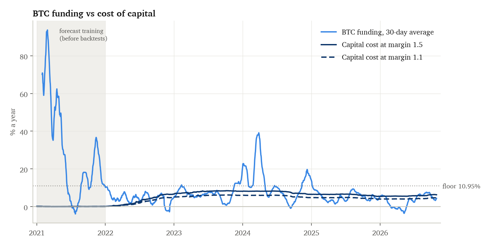
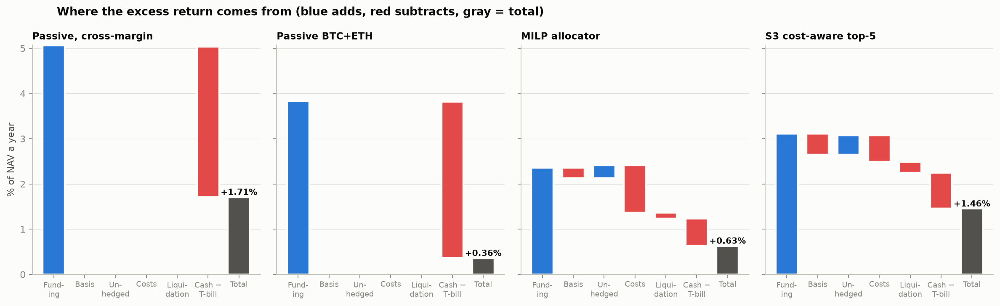

# Crypto Cash-and-Carry: Capital Efficiency in the Spot–Perpetual Basis Trade

### Limits to arbitrage, forecastability and the cost of capital, 2021–2026

Michael Jung · October 2026 · Code and data pipeline: this repository

---

## Abstract

Perpetual futures pay a periodic *funding rate* that transfers money from leveraged longs to shorts
when the contract trades above spot. A long-spot / short-perp position collects that funding with
no price exposure, which makes it economically a secured loan: cash lent against crypto collateral.
Using free exchange data for 274 coins on Binance and Bybit from January 2021 to October 2026,
including coins later delisted, I test four questions under pre-registered decision rules and a
multiple-testing correction across every variant run.
(1) **Cross-venue arbitrage:** funding on the two venues is 0.95 correlated since 2023 and gaps decay
with a half-life of about 4.5 hours; gaps collectable after costs were too rare to trade (pre-registered
NO-GO). (2) **Carry levels:** the exchange-fixed funding floor of 0.01% per 8 hours (10.95% a year) did
not move while T-bills rose from 0% to 5%, so carry over cash compressed from about 11% in 2021 to
1–6% afterwards. (3) **Forecastability:** funding is forecastable across coins out of sample (rank IC
about 0.5), but the gain from selection is about the size of the cost of rotating into it.
(4) **Allocation:** neither cost-aware selection nor a daily mixed-integer allocator (HiGHS) beat
passive BTC+ETH carry after costs. The decisive variable is capital structure: the trade breaks even
at about 1.4× capital per $1 of notional, and under realistic portfolio margin (about 1.05×) passive
BTC+ETH earned +1.9% a year over T-bills. The carry that survives is a financing spread, and it is
captured by cheap balance sheet rather than by signals.

---

## 1. Introduction

Perpetual futures ("perps") are the main instrument for leveraged crypto exposure. With no expiry to
pull their price to spot, exchanges instead charge a *funding rate* every 1–8 hours. When leveraged
demand pushes the perp above spot, longs pay shorts. A trader who buys spot and shorts the perp is
price-neutral and collects that payment: the crypto analogue of a Treasury cash-and-carry trade
funded in repo.

The trade looks like free money in bull markets, when funding has exceeded 30% a year. This paper
asks what is left once funding is measured against the cost of cash, trading costs and the capital
the position ties up, and whether forecasting or optimisation can improve on simply holding it.

The framing borrows from the literature on limits to arbitrage. Covered-interest-parity deviations
persist because bank balance sheets are costly (Du, Tepper and Verdelhan, 2018); arbitrage is limited
whenever it needs scarce capital (Shleifer and Vishny, 1997). Carry in general earns a premium for
bearing crash risk (Koijen, Moskowitz, Pedersen and Vrugt, 2018), and crypto carry in particular has
been large and crash-prone (Christin et al., 2022; Schmeling, Schrimpf and Todorov, 2023). The
mechanics of perp pricing are set out by He, Manela, Ross and von Wachter (2022).

**Contributions.**
1. A survivorship-free, two-venue dataset of funding, spot and perp prices for the point-in-time top 30
   coins, 2021–2026, built entirely from free sources, with stock and commodity perps excluded by rule.
2. Evidence that the two largest venues are tightly integrated: cross-venue funding gaps sit inside
   the round-trip cost band.
3. A decomposition of why carry compressed after 2021, separating mechanical (fixed floor vs rising
   rates) from behavioural causes (leverage demand, arbitrage capital).
4. Out-of-sample tests of funding forecasts and of a cost-aware MILP allocator against passive carry,
   with every decision rule fixed before the test and a deflated Sharpe across all 16 variants.
5. A capital-structure sensitivity showing the trade's break-even margin factor and the limited value
   of leverage, checked against venues' published margin parameters.
6. A matched test that the no-arbitrage band widens with transfer frictions, using an on-chain venue.

## 2. Background: how funding works

Binance-style funding per 8-hour period is

> funding = premium + clamp(interest − premium, −0.05%, +0.05%), with interest = 0.01%,

where *premium* is the perp's average premium to the spot index over the period. For any premium
between about −0.04% and +0.06%, the clamp returns funding to exactly **0.01% per 8 hours (10.95% a
year)**. This *floor* behaves like an administered policy rate: funding sits on it in calm markets and
moves away only when leveraged demand is strong in one direction.

A position of *q* coins long spot and *q* coins short the perp earns, each period:

> P&L = q × perp price × funding − q × Δ(perp price − spot price) − trading costs,

and ties up capital equal to the spot notional plus margin for the short. Against the alternative of
holding T-bills, the trade's excess return is approximately

> excess ≈ funding ÷ m − T-bill − costs,

where *m* is the **margin factor**: capital tied up per $1 of notional. With spot held in a separate
account and a prudent buffer on the short, *m* ≈ 1.5; under portfolio margin, where spot counts as
collateral at a 95% ratio, *m* ≈ 1.0–1.05.

## 3. Data

| Source | Use |
|---|---|
| Binance USD-M API and archive (data.binance.vision) | Funding since 2019-09, daily volume, 8-hour spot and perp bars; archive for delisted symbols the API no longer serves |
| Bybit v5 API and public archive | Funding since 2021, daily volume, 8-hour bars (built from 4-hour bars); spot only from July 2021 |
| FRED `DGS3MO` | 3-month T-bill, lagged one day |

**Universe.** Each month, the top 30 coins by trailing 30-day Binance perp volume among coins traded on
both venues, using only data before the month: **274 distinct coins**, including coins later delisted
(both venues still serve their history). Stock, ETF and commodity perps, launched in 2025 and by 2026
holding about a third of the top-30 volume slots, are excluded by Binance's own `TRADIFI_PERPETUAL`
tag (one ticker clash, CAT, resolved in favour of the crypto token).

**Common grid.** Venues settle some coins every 1 or 4 hours, so all payments are summed into 8-hour
windows ending 00:00, 08:00 and 16:00 UTC. Prices are 8-hour closes stamped at the bar's close; bars
still forming are dropped. Perp prices are divided by contract multipliers (1000PEPE, 1MBABYDOGE).

**Investable set.** A coin is investable on a venue when it is in that month's universe, has a spot
market there, and its basis is within ±20% (larger prints are collapses or broken spot/perp pairs,
e.g. LUNA in May 2022). Coverage under 0.5% missing; about 25 investable coins per venue.

## 4. Research protocol

Every test followed the same protocol, recorded in a dated decisions log:

1. **Pre-registration.** Each phase's test, models and decision rule were written down before any
   result was seen. Rule clarifications were made only before running.
2. **No look-ahead.** Forecasts are walk-forward with monthly refits; a training row is used only if its
   target window ends before the refit date. A test scrambles all data after a cut-off and checks that
   no earlier forecast changes; it was confirmed to catch a leaky version.
3. **Multiple testing.** Every strategy variant is a trial, and results are reported with the deflated
   Sharpe ratio (Bailey and López de Prado, 2014) across all of them: 16 by the end.
4. **Conservative assumptions.** Taker fees on every trade (0.10% spot, 0.05–0.055% perp) plus 2 bp
   slippage per leg (about 0.38% per round trip); liquidation of the short when its price rises 40%
   since the daily margin top-up (2% penalty); one-window execution lag; forced exits at full cost.
5. **Corrections published.** Three engine bugs were found after first results (Section 8); each was
   fixed with a regression test, every affected phase was rerun, and the original numbers are kept in
   the log. No decision changed.

The backtest engine runs both venues on the 8-hour grid and splits P&L into funding, basis change,
trading costs, liquidation penalties and cash interest; the components sum to the equity change exactly.

## 5. Results

### 5.1 The venues are integrated: cross-venue gaps sit inside the cost band

The first hypothesis was that an optimiser could move capital between venues to harvest funding
differences. The pre-registered test: enter a long/short perp pair on the trailing 3-day Binance–Bybit
gap, collect the gap over 7 days, and require the top quintile to beat the 21 bp taker round trip on
average **and** in at least 4 of 6 years.

| | 2021 | 2022 | 2023 | 2024 | 2025 | 2026 |
|---|---|---|---|---|---|---|
| Venue funding correlation | 0.71 | 0.82 | 0.95 | 0.95 | 0.94 | 0.95 |
| Top-quintile 7-day gap collected (bp) | 55.8 | 17.6 | 21.1 | 21.0 | 20.3 | 9.8 |

The top quintile collected 25.0 bp on average but cleared the cost in only 3 of 6 years: **NO-GO**. The
median absolute gap is 0.2–0.7 bp per 8 hours, and gaps decay with a half-life of about 4.5 hours.
Arbitrage capital keeps the two largest venues' funding within the cost of moving between them, the
pattern predicted by limits to arbitrage. The project pivoted to single-venue carry.

### 5.2 Why carry compressed after 2021

| Year | Context | BTC funding % a year | Median coin funding | T-bill | % prints negative | Median basis (bp) |
|---|---|---|---|---|---|---|
| 2021 | Bull market, retail leverage | 30.6 | 10.95 | 0.05 | 8% | +3.3 |
| 2022 | LUNA, 3AC/Celsius, FTX | 4.2 | 2.9 | 2.1 | 42% | −6.1 |
| 2023 | Recovery; policy rate ~5% | 7.9 | 10.95 | 5.3 | 19% | −3.7 |
| 2024 | Spot BTC ETFs, rally | 11.9 | 10.95 | 5.2 | 13% | −1.9 |
| 2025 | Weaker leverage demand | 5.1 | 6.75 | 4.2 | 29% | −4.9 |
| 2026 (to Oct) | BTC mostly below the floor | 3.1 | 4.8 | 3.8 | 33% | −5.7 |

Five drivers, four measured here and one a hypothesis:
1. **The floor is fixed by the exchange, not by rates (measured).** At 10.95% a year it paid about 11%
   over cash in 2021 and about 6% on notional once T-bills reached 5%; about 2.5% on capital at m = 1.5.
2. **Leverage demand is cyclical (measured):** 30.6% BTC funding in 2021, negative 42% of the time in 2022.
3. **More arbitrage capital on the short side (hypothesis, not tested):** spot ETFs and Ethena's USDe
   (both 2024) industrialised long-spot/short-derivative positions.
4. **The basis has been negative since 2022 (measured):** short demand outweighs leveraged long demand.
5. **Venue changes (measured):** new coins increasingly list as perps only (spot coverage of the top 30
   fell from 100% in 2021–23 to 72–78% in 2026), small-coin funding became squeeze-driven and negative
   (worst: −13.6% in one 8-hour window), and settlement moved to 4- and 1-hourly.



*Figure 1. BTC funding (30-day average) against the cost of capital with and without cross-margining.
Carry exists only when funding is above the capital-cost line: continuously in 2021, in bursts after.*

### 5.3 Funding is forecastable, but the edge is about the size of costs

Target: mean funding over the next 7 days, for investable coins. Out of sample from 2022:

| | Mean absolute error | Rank IC across coins | Top fifth minus all (% a year) |
|---|---|---|---|
| Floor (always 0.01%) | worst | — | — |
| Last value | beaten by EWMA every year | 0.37–0.60 | 4.6–10.5 |
| EWMA (1–3 day half-life) | best simple model | 0.49–0.70 | 6.5–15.2 |
| Pooled regression | best in 4 of 5 years (selected) | 0.47–0.68 | 6.3–16.8 |

A rank IC around 0.5 is very high by equity-factor standards: funding is persistent across coins even
though individual prints revert within a day. But the top fifth earned 6–17% a year more than the
average coin *before costs*, while a full weekly rotation at 0.38% per round trip costs about 15.6% a
year. The regression's advantage came almost entirely from predicting recovery from negative funding;
at the floor it was the worst model.

### 5.4 Selection and optimisation did not beat passive carry

All strategies run on $1M across both venues, January 2022 to October 2026, in excess of T-bills.

| Strategy | Margin | Excess % a year | Sharpe | Turnover × NAV | Deflated Sharpe |
|---|---|---|---|---|---|
| Passive BTC+ETH | 1.50 | 0.36 | 1.10 | 0.1 | 2% |
| Naive top-5 by forecast, weekly | 1.50 | −4.31 | −1.68 | 31.3 | 0% |
| Cost-aware top-5 (pre-registered primary) | 1.50 | 1.46 | 0.83 | 3.0 | 1% |
| MILP allocator (pre-registered primary) | 1.50 | 0.67 | 0.67 | 5.3 | 0% |
| MILP with churn controls | 1.05 / 1.30 | 1.53 | 1.32 | 4.1 | 3% |
| **Passive BTC+ETH, portfolio margin** | **1.05** | **1.94** | **4.18** | 0.2 | **100%** |

Each pre-registered comparison was negative: cost-aware selection vs passive (P(not better) = 0.51),
the MILP vs passive (0.63), and the churn-controlled MILP vs passive at the same realistic margin (0.99).


*Figure 2. Cumulative excess return. Almost all gains arrive in two 2024 bursts; flat stretches are
periods fully in T-bills.*

The **MILP** (solved daily with HiGHS) maximises 30-day expected funding minus the T-bill on capital
used, minus one-off trading costs and a risk penalty for small and young coins, subject to capital per
venue, per-coin and liquidity caps, a $10k minimum position, at most 12 positions, a 60% per-venue
exposure cap, and minimum-size, one-day-delayed transfers between venues. It behaved as designed:
fully invested in high-funding bursts, in T-bills otherwise, with liquidations and venue exposure
controlled. But it collected 2.4% of NAV in funding and paid 1.1% in costs, mostly through about 100
opens and closes a year. Adding an exit-side turnover penalty and a no-trade band cut that by a third
and doubled its return, still well short of the passive benchmark under the same margin.



*Figure 3. Where the excess return comes from. The largest drag in every strategy is "cash minus
T-bill": capital tied up in positions that earns nothing.*

### 5.5 Capital structure decides the outcome

Passive BTC+ETH, held at constant exposure (weekly rebalance with a 5% band):

| Margin factor | 1.00 | 1.05 | 1.10 | 1.20 | 1.30 | 1.50 | 2.00 |
|---|---|---|---|---|---|---|---|
| Excess % a year | +1.71 | +1.43 | +1.18 | +0.74 | +0.36 | −0.24 | −1.21 |
| Sharpe | 2.83 | 2.49 | 2.15 | 1.47 | 0.78 | −0.59 | −4.04 |

The formula excess ≈ funding ÷ m − T-bill − costs reproduces these numbers to within a few basis
points. With 6.4% funding on notional and 4.1% T-bills, **the trade breaks even at about m = 1.4**, and
each +0.1 of margin factor costs about 0.4–0.5% a year. Venue documentation puts realistic BTC/ETH
portfolio margin at 1.0–1.05 (95% collateral ratio, 0.40% maintenance margin).

**Leverage helps little.** At m = 1.05 with the extra notional borrowed at T-bill + 1%, going from 1× to
3× raises the excess from +1.41% to +2.28% but quadruples the drawdown (−2.1% to −8.5%); at an 11%
exchange loan rate, 3× loses 9.6% a year. Funding must beat the borrow rate plus costs, and exchange
borrow rates tend to rise with funding.

**Costs matter most for active strategies.** Halving fees adds about 0.3% a year to passive carry and
doubling them costs about 0.5%; for the MILP the same changes move the return from +0.67% to +0.82%
and +0.31% (and to +1.06% at a quarter of base costs). Cheaper costs made cost-aware selection
*worse*, because its cost-scaled entry hurdle had been acting as a quality filter against small coins.

### 5.6 Larger frictions widen the band (on-chain venues)

If limits to arbitrage set the band, it should be wider where moving capital is harder. Hyperliquid, an
on-chain venue with the same funding design as Binance (a 0.01% floor), provides that test from late 2023:
capital moves there by bridging stablecoins rather than an exchange withdrawal. On matched coin-windows:

| | Binance–Hyperliquid | Binance–Bybit (matched) |
|---|---|---|
| Median \|gap\| (bp per 8h) | 0.62 | 0.32 |
| 90th percentile \|gap\| | 3.40 | 1.63 |
| Top-quintile gap collected over 7 days | 46 bp | 13 bp |
| Top-quintile trades beating the taker round trip | 69% | 24% |

Gaps are about twice as wide, close more slowly in 2025–26, and, unlike the centralised pair, the largest
of them cleared trading fees most of the time, before the bridging costs and on-chain risks that keep
them open. The pre-registered prediction (wider *and* slower-closing gaps than Binance–Bybit in at least
2 of 3 years, for both on-chain pairs) holds. The band is narrowing, though: the top-quintile gap fell from
54 bp (2024) to 14 bp (2026). A second on-chain venue, dYdX, also passes the test, but its funding has no
floor or dead zone, so its gaps are largely mechanical and are not counted as evidence about frictions.

## 6. Discussion

The carry that survived 2021 is a **financing spread**: funding at or near an administered floor,
earned against the cost of cash. Three features make it hard to improve on by selection:

- **It is earned in bursts.** Most of 2022–2026's carry arrived in two 2024 rallies; in between,
  funding sat at or below the capital cost and the right position was T-bills.
- **The extra carry in small coins is expensive to reach.** Higher funding there comes with higher
  margin factors, basis losses, liquidations, delistings and no spot market at all for a growing share
  of new listings.
- **The asymmetry protects the passive side.** Collecting positive funding needs only cash, which is
  plentiful, so it is competed down to roughly the cost of capital. Collecting negative funding needs
  borrowed coins, which are scarce, so negative funding persists in exactly the coins hardest to borrow.

What does move returns is the balance sheet: the margin factor, whether collateral earns interest,
and execution cost. That is the same set of levers a prime-brokerage or treasury desk manages, and it
fits the limits-to-arbitrage view: the binding constraint on arbitrage is the cost of capital.

## 7. Limitations

- **Short sample, few regimes.** Five out-of-sample years, with most P&L in 2024; the Sharpe ratios of
  low-volatility carry overstate its quality because tail events (exchange failure, stablecoin de-pegs,
  liquidation cascades) barely appear in daily volatility.
- **Simplified execution.** 8-hour closes only (no intra-bar moves), flat base-tier fees across time,
  constant slippage, an approximate liquidation rule, and margin modelled as a factor rather than each
  venue's full margin engine.
- **No borrow data.** Historical coin borrow rates are not public, so the reverse trade (long perp,
  short spot) could not be tested.
- **Opportunity cost.** T-bills are used as the cost of cash; crypto-native alternatives (stablecoin
  lending) may differ.
- **Access.** Neither venue serves Canadian (Ontario) residents; the results describe the market, not
  a strategy available to the author.

## 8. Robustness and corrections

Four errors were found after first results and corrected; the log keeps the original numbers.

| Found by | Problem | Fix | Effect |
|---|---|---|---|
| Engine refactor | Entering a coin with spot but no perp price produced NaN equity, silently dropping 20 months of one variant | Require both prices; engine fails loudly on non-finite equity | One robustness variant: Sharpe 2.34 → 1.20 |
| Extending to 30-day forecasts | Walk-forward leakage gap hard-coded to 7 days | Gap equals the target length; leak test extended | Prevented a leak before any 30-day result |
| Charts of positions | Delisted coins (MATIC after its POL migration) held forever with no price | Close after 3 days without a price, at last prices | All active strategies improved; no decision changed |
| Trading counts | Engine re-traded positions the MILP had left unchanged, chasing stale dollar targets | Pass "hold" instead of a dollar amount | MILP resizes fell from ~615 to ~105 a year |

## 9. Conclusion

From 2021 to 2026, crypto basis carry moved from a high-return trade to a financing spread. The two
largest venues are integrated within their cost band; carry over cash compressed because the funding
floor is fixed while rates rose; funding is forecastable but the forecastable part is about the size
of the cost of acting on it; and neither selection nor a constrained optimiser beat holding BTC and
ETH carry passively. Under realistic portfolio margin that passive position earned +1.9% a year over
T-bills. The returns were decided by capital structure and costs rather than by signals.

Where moving capital is harder, the band is wider: Binance–Hyperliquid gaps are about twice the
Binance–Bybit gaps on the same coins, and their largest gaps cleared trading fees, consistent with the
frictions fees do not capture. That band has been narrowing as arbitrage capital moves on-chain.

## References

- Bailey, D. H. and López de Prado, M. (2012). The Sharpe ratio efficient frontier. *Journal of Risk*.
- Bailey, D. H. and López de Prado, M. (2014). The deflated Sharpe ratio. *Journal of Portfolio Management*.
- Christin, N., Routledge, B., Soska, K. and Zetlin-Jones, A. (2022). The crypto carry trade. Working paper.
- Du, W., Tepper, A. and Verdelhan, A. (2018). Deviations from covered interest rate parity. *Journal of Finance*.
- He, S., Manela, A., Ross, O. and von Wachter, V. (2022). Fundamentals of perpetual futures. Working paper.
- Koijen, R., Moskowitz, T., Pedersen, L. and Vrugt, E. (2018). Carry. *Journal of Financial Economics*.
- Schmeling, M., Schrimpf, A. and Todorov, K. (2023). Crypto carry. BIS working paper.
- Shleifer, A. and Vishny, R. (1997). The limits of arbitrage. *Journal of Finance*.

## Appendix: reproducing the results

```bash
python -m venv .venv && .venv/bin/pip install -e ".[dev]"
.venv/bin/python research/build_data.py           # data (~1.5 h first time; resumable)
.venv/bin/python research/phase1_descriptives.py  # cross-venue test and descriptives
.venv/bin/python research/phase2_forecast.py      # investable set, basis, forecasts
.venv/bin/python research/phase3_backtest.py      # strategy backtests
.venv/bin/python research/phase4_allocator.py     # MILP allocator
.venv/bin/python research/phase4b_allocator.py    # MILP with churn controls
.venv/bin/python research/sensitivity.py          # margin, leverage, costs
.venv/bin/python research/figures.py              # figures
.venv/bin/pytest                                  # 19 tests
```

Phase write-ups: `docs/phase1.md` to `docs/phase4b.md`, `docs/sensitivity.md`. Pre-registered specs:
`docs/plan.md`. Every decision and correction: `docs/decisions.md`.
