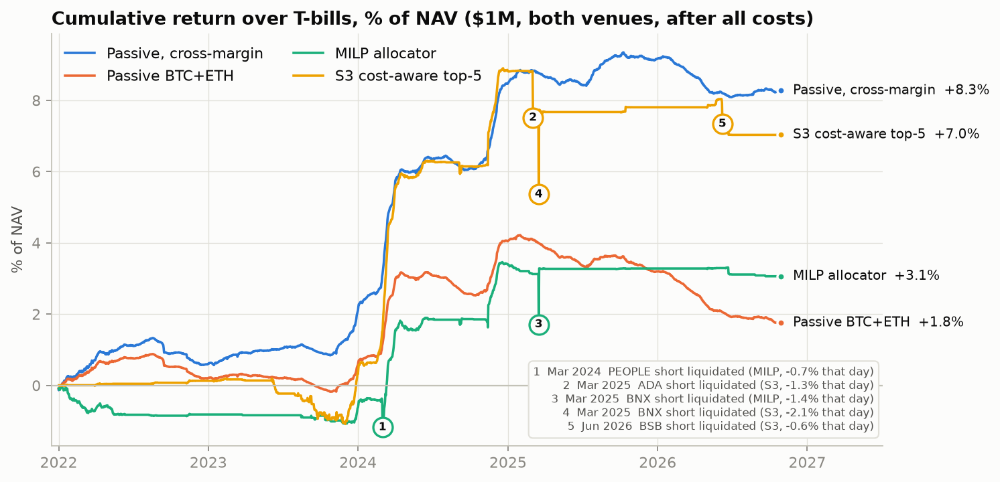

# Crypto Cash-and-Carry: Capital Efficiency in the Spot–Perpetual Basis Trade

*Summary version. Full paper: `docs/paper.pdf`.*

## Question

Buying spot crypto and shorting the perpetual future ("perp") collects the perp's **funding rate** with no
price exposure: economically, a secured loan of cash. Funding has an exchange-set floor of 0.01% per
8 hours (**10.95% a year**). Can the trade be improved by forecasting funding, or by optimising which
coins to hold and how much?

> **Excess return over T-bills ≈ funding ÷ margin factor − T-bill rate − trading costs**,
> where the margin factor is the capital tied up per $1 of notional.

## Approach

- **Data:** Binance and Bybit, 2021–2026: funding, volume and 8-hour prices for 274 coins, including later
  delisted ones. Each exchange is a separate $500k book.
- **Forecasts:** four models of each coin's next-7-day funding, trained on 2021 and tested out of sample
  from 2022 with monthly walk-forward refits.
- **Strategies:** passive BTC+ETH; rotating into the top 5 by forecast, with and without a cost hurdle;
  and a daily mixed-integer optimiser (MILP, HiGHS) choosing coins and sizes under capital, liquidity and
  per-coin limits.
- **Discipline:** every decision rule written down before the test ran; every variant (23) counted when
  judging significance.

## Findings

- **Carry over cash collapsed after 2021.** Passive BTC+ETH earned +12.6% over T-bills in 2021, then
  +0.4% a year in 2022–26: the funding floor stayed fixed while T-bills rose from 0% to 5%.
- **Funding is forecastable, but the edge is the size of the cost.** A pooled regression ranks coins well
  (rank IC about 0.5): the top fifth earns 9.7% a year more than the average coin. But about half of it
  changes each week, and rotating costs 10.4% a year.
- **No active strategy beat passive** at the same margin on a risk-adjusted basis, and none survives the
  correction for the number of variants tried. Naive rotation lost to costs; the cost-aware rule sat
  mostly in cash; the MILP gave its carry back in about 90 opens and closes a year; small coins brought
  liquidations.
- **Capital structure decides the outcome.** The trade breaks even at about **1.4×** capital per $1 of
  notional. Under portfolio margin (1.05×), passive BTC+ETH earned **+1.9% a year over T-bills (Sharpe
  4.2)**, the only result that survives the multiple-testing correction.

| 2022–2026 | Margin | Excess return a year | Sharpe | Turnover (× capital) |
|---|---|---|---|---|
| Passive BTC+ETH | 1.50 | +0.36% | 1.10 | 0.1 |
| Naive top 5 | 1.50 | −4.31% | −1.68 | 31.3 |
| Cost-aware top 5 | 1.50 | +1.46% | 0.83 | 3.0 |
| MILP | 1.50 | +0.63% | 0.55 | 5.2 |
| MILP with turnover controls | 1.05 / 1.30 | +1.45% | 1.21 | 4.2 |
| **Passive BTC+ETH, portfolio margin** | **1.05** | **+1.94%** | **4.18** | 0.2 |

*Figure 1. Cumulative return over T-bills, $1M across both exchanges, after all costs (2022–2026).
Numbered dips are short-perp liquidations on small coins.*

## Conclusion

The carry that survived 2021 is a **financing spread**: funding near an exchange-set floor, earned against
the cost of cash. Selection and optimisation cannot improve it after costs. What moves returns is the
balance sheet: **the margin factor, whether collateral earns interest, and execution cost**.

**Limitations:** five out-of-sample years with most of the P&L in 2024; low-volatility carry flatters the
Sharpe ratio (exchange failure and de-pegs barely appear in the data); 8-hour prices, flat base-tier fees
and a simplified liquidation and margin model.
